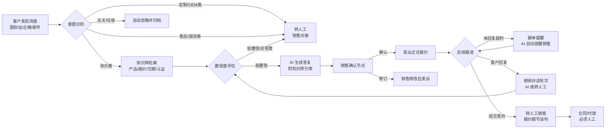
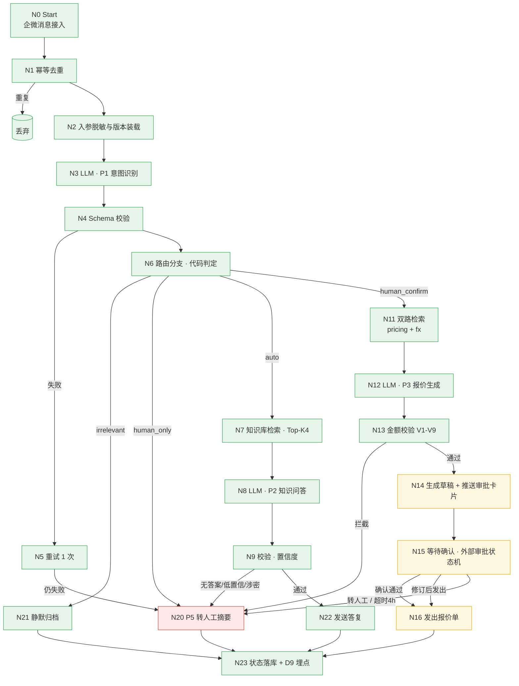

# 询盘全流程与自动化边界图（D2）

> 案例A · Phase 0 交付物 D2
> 用途：向客户/评审人讲清楚"数字员工在询盘链路中做什么、不做什么、哪些需要人"
> **版本**：v0.1（2026-10-13 审计 F1 返工后）｜ **状态**：文档定稿；实操待 Phase 1 落地验证
>
> **定位声明**：本案例为**个人自演示 Demo**，客户画像为**虚构典型客户**（广州星航贸易有限公司），**非真实客户交付**。本文所有占比、时效、工时数字均为**演示测算模型口径（基线为假设值）**，不得被误读为实测数据（D13 §3.1）。

---

## 1. 询盘全流程总览（Mermaid）



> **修订说明（2026-10-13，审计 F1）**：① 原「AI 生成初步回复**附报价区间**」违反 D4 §4.1「不得给出估算价、参考价、**区间价**」红线，已改为「附知识库引用答复」；② 原流程图未体现「询价类一律进人工确认」的 D4 §2.2 硬规则，易被读作 B1-a 方案残留，本次在 §2/§3 明确（流程图为总览，路由规则以 §2 边界矩阵与 D4 §2.2 为准）。

### 1.1 完整流程图（对应 D3 节点 N0-N24 主流程，三色标注）

> 三色标注规则与主文档 D2 定义一致（自动化率 ≥40% / 转接率 ≤60% 口径）：
> - 🟢 可自动化（计入 AI 闭环完成数）：N0-N13 处理、N21 归档、N22 发送答复、N23 状态落库
> - 🟡 需确认（人工确认后发出，计入人工转接率）：N14 草稿推送、N15 等待确认、N16 发出报价单
> - 🔴 需人工 / 异常转人工（计入人工转接率）：N20 转人工摘要；human_only 路由（定制/售后/物流付款）不经自动化直接转人工；合同/付款必须人工



> 渲染说明：本机未安装 mermaid-cli（mmdc），未导出 PNG；上方 mermaid 源可用于渲染（支持 mermaid 的 Markdown 查看器/编辑器可直接渲染）。

## 2. 自动化边界矩阵

| 环节 | AI 闭环 | 人工确认 | 必须人工 | 说明 |
|------|:---:|:---:|:---:|------|
| 询盘接收与分流 | ✔ | | | 意图分类：询价/定制/售后/无关 |
| 产品知识问答（参数、认证、起订量、交期、样品） | ✔ | | | 依赖知识库，答案高置信且带引用才直接回；**不含任何价格数字输出**（价格类一律走人工确认） |
| 初步报价生成 | | ✔ | | AI 按规则生成报价单，销售确认后发出；**询价一律经人工确认**（D4 §2.2） |
| 定制需求（OEM/ODM）对接 | | | ✔ | AI 仅收集信息，转销售 |
| 售后 / 投诉处理 | | | ✔ | 必须人工，AI 附上下文转接 |
| 跟单提醒（超时未跟进） | ✔ | | | 自动提醒销售，不代替销售跟进 |
| 报价细节谈判 | | | ✔ | 只转人工 |
| 合同签署 | | | ✔ | 不触碰 |
| 付款环节 | | | ✔ | 不触碰 |
| 无关垃圾询盘 | ✔ | | | 自动过滤归档（**不计入 AI 闭环完成数**，D3 §6.2） |

> **修订说明（2026-10-13，审计 F1）**：① 原「产品知识问答（**价格区间**、起订量…）」中的「价格区间」与 D4 §4.1 区间价红线冲突，已删除；② 原「初步报价生成」行未标注「询价一律经人工确认」，与 D4 §2.2 / D3 §7.3 B1-b 拍板不符，已补。

## 3. 人工确认节点（黄色安全阀）

```
AI 初步回复 ──→ 销售确认 ──→ 发出
                ├─ 确认（超时 4 小时未确认 → 升级转人工 escalate，**绝不自动发出**）
                ├─ 修订后发出
                └─ 转人工深度对接
```

- 默认策略：**询价类一律进人工确认**（D4 §2.2 硬规则，B1-b 拍板口径）；高置信仅作用于 P2 知识问答链路（产品参数 / 起订量交期）；任何涉及价格承诺、定制承诺、交期承诺 → 一律经销售确认
- 超时策略：销售确认节点超时 **4 小时**未操作 → 升级转人工 escalate，**绝不自动发出**（2026-10-08 按 B3 拍板修订）
- 兜底策略：AI 无法给出高置信答案 → 转人工，不编造

## 4. 指标埋点位置

| 指标 | 埋点位置 | 口径 |
|------|----------|------|
| 自动化处理率 | 意图识别 → 回复闭环 计数 | AI 闭环完成数 ÷ 总询盘数（**不含需人工确认、不含静默归档的无关单**，D3 §0/§6.2） |
| 人工转接率 | 转人工节点 计数 | （需人工确认 + 必须人工 + 异常转人工）÷ 总询盘数，与自动化率互补 |
| 响应时间 | 询盘进入 → **收到最终答复** 计时 | **端到端口径**；与消息回执时延口径分离，**不得互证**（D6 §2.3 / 主文档 Phase 2 验收） |
| 报价一致性 | 报价单生成 → 销售确认 抽检 | 容差 ±5% |
| 节省工时 | 人工单条耗时 × 处理量 | **净节省分钟数 × 对应链路处理量**（D1 §8 口径：auto 5 分钟/条、需人工确认 3 分钟/条、必须人工 0 分钟/条）；**不采用**「15 分钟 × 全量」的乐观算法 |

> **修订说明（2026-10-13，审计 F1）**：① 原「响应时间 = 询盘进入 → **首次有效回复**」改为端到端口径（询价单的「首次有效回复」是 AI 草稿、不发给客户，该计时点不存在）；② 原「节省工时 = 人工单条耗时 × AI 闭环条数」是 D1 §8 明确否决的乐观算法，已改为净节省口径；③ 补「自动化处理率不含归档单」与「双口径不得互证」两处统一口径。

---

*（配套 D1 使用；流程节点与边界口径与《案例A_实施步骤与交付物清单.md》Phase 1/2 保持一致）*

*本材料为案例A个人自演示 Demo 的 Phase 0 交付物，客户画像为虚构典型客户，全部数字均为演示测算模型口径（基线为假设值），非真实客户交付。*
