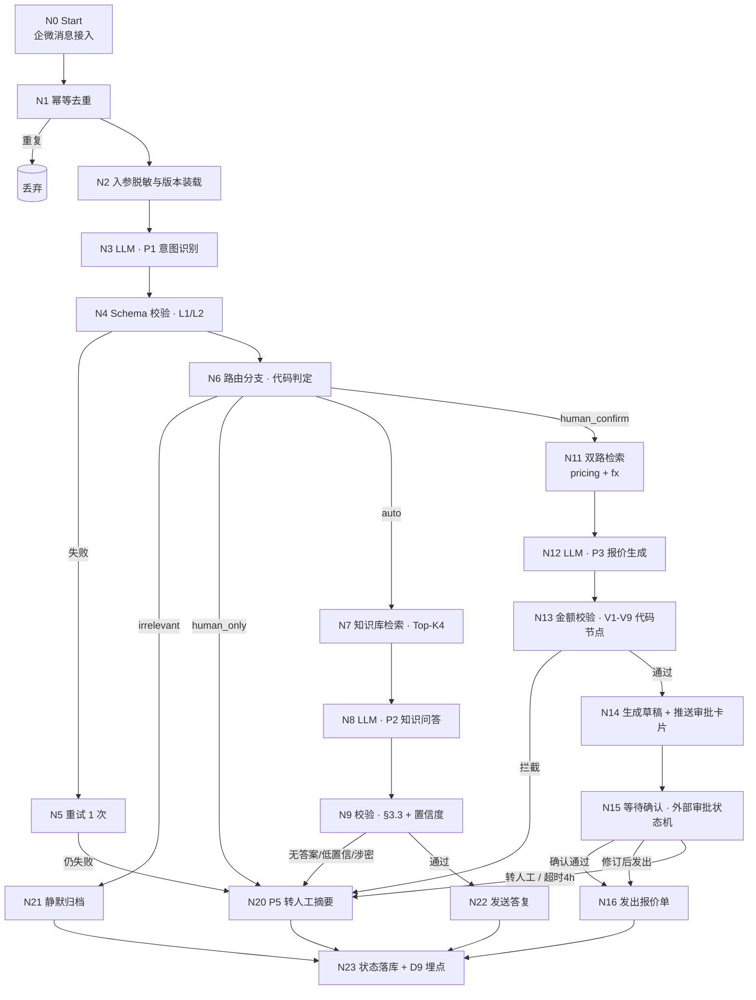
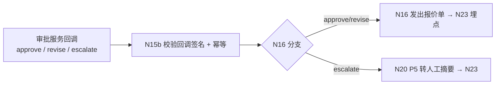
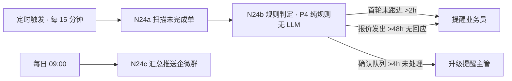
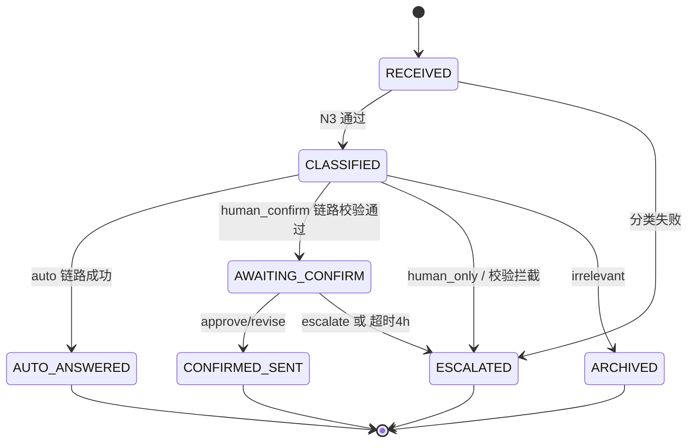

# 数字员工工作流设计文档 —— 外贸询盘处理数字员工（案例A · D3）

> 案例：案例A「外贸询盘处理数字员工端到端交付（个人自演示 Demo）」
> 交付物：**D3 工作流设计文档** ｜ Phase：Phase 1 数字员工搭建（低代码平台）
> 版本：v0.2（已拍板）｜ 状态：待 Phase 1 验收 + DSH 审计后升 v1.0
>
> 配套文档：**D4** Prompt 体系（本文每个 LLM 节点调用 D4 的 Prompt 单元）、**D5** 知识库构建包（本文检索节点的数据源与访问分级）、**D1** 客户发现简报（§5 三色边界为本文的流程边界依据）、**D12** 样本集（本文的验收与回归载体）

---

## 0. 术语、边界与本文不承载的内容

| 术语 | 定义 | 归属 |
|------|------|------|
| **AI 闭环完成** | 数字员工无需人工介入即完成答复的询盘（不含需人工确认单、不含静默归档的无关单） | D1 §5.1 / D9 |
| **需人工确认** | AI 起草报价，人工审核后发出；确认通过计入**人工转接率**分子 | D1 §5.1 |
| **异常转人工** | 进入自动化流程后失败（校验未过/无资料/超阈值/超时未确认/系统错误）的询盘 | D1 §5.1 |
| **强制转人工** | 由硬性规则触发、不可被模型自行放行的转人工 | D4 §4 |

> **本文边界（越界不写，避免与 D4/D5/D12 双归属）**：
> 1. **不承载 Prompt 原文与 Schema** —— 一律引用 D4（P1–P5、§4.3 校验、§7 总则）；
> 2. **不承载知识库资料与切分规则** —— 一律引用 D5；
> 3. **不承载测试用例与样本清单** —— 一律引用 D12，本文只登记「哪个节点被哪类样本覆盖」；
> 4. **不承载变更触发范围** —— 一律引用 **D4 §6.4**（唯一引用口径）；
> 5. **不承载价格数值** —— 报价阈值与底价均在 D5，本文只引用阈值判定动作。

---

## 1. 平台与技术栈锁定（Phase 1 动作 1）

| 项 | 决策 | 说明 |
|----|------|------|
| 主平台 | **Dify**（主推云端 SaaS 版；私有化 Docker Compose 为备选形态） | 主文档 Phase 1 动作 1 已锁定，本文不再「二选一」 |
| 对比备选 | **Coze**：仅作对比备选，不并行推进、不产出第二套工作流 | 同上 |
| 离线备选形态 | **enterprise-agent**：自研离线改造版，基于开源框架二次开发；**上游项目名与版本在 D7 部署手册中锁定并注明**；仅用于无网/低配环境演示，Phase 3 备选 | 消除审计报告 #5 的「凭空冒出」 |
| 编排形态 | 云端形态下采用 **双工作流 + 外部审批状态机**（见 §4.2）；不用 Chatflow 的 User Input 模拟审批 | 见下方「平台能力声明」 |
| 知识库 | Dify Knowledge（向量检索 + 关键词混合），Top-K = 4 | 数据源与分级见 D5 |
| 版本变量 | 工作流全局变量 `PR_VERSION` / `PT_VERSION`，与 D4 §6.1 命名规则一致、三处登记一致（D4 §6.1/§6.3） | D4 §6.1 / §6.3 |

> ⚠️ **平台能力声明（待核实，标注为存疑而非已证）**：本文档按「所用 Dify 版本**未提供**可直接用于企微场景的原生人工审批节点」这一前提设计（依据：既有认知，非本轮实测；本会话联网查证不可用）。
> - 该前提**须在 Phase 1 搭建时以所用 Dify 版本为准实测核实**；若所用版本已提供原生审批节点，则 §4.2 方案 A 可简化为原生节点，其余节点设计不受影响。
> - **即便原生节点可用，§4.2 的选型理由仍然成立**：企微场景下「下一条消息」不宜被当作审批输入（方案 B 的排除理由与平台能力无关）。
> - 人类确认环节由「外部轻量审批服务 + 双工作流」实现（§4.2），该服务是本文引入的唯一自研组件，其部署与运维归入 D7，交接归入 D8。

---

## 2. 工作流总览

### 2.1 主链路（WF-Main）



### 2.2 审批回调链路（WF-Confirm，独立工作流）



### 2.3 跟单提醒（WF-Followup，定时触发，独立工作流）



> **⚠️ 4h 双口径说明（审计#18 修订）**：「确认队列 >4h 未处理 → W2 升级提醒主管」与主链路 N15「超时 4h → escalate」（§4.3）是**同一 4h 事件的两种动作**：审批服务在 4h 超时执行 escalate（终态，绝不自动发出报价），同时触发 W2 通知主管接单处理，并非两套互相竞争的策略。

---

## 3. 节点清单与详设

> 节点 ID 为本文唯一编号，回归时按节点定位；「调用 D4」列指向 D4 的 Prompt 单元或校验项。
> **编号说明（审计#16）**：N10/N17/N18/N19 为预留扩展位，当前版本不使用（§2.1 图与节点清单均无对应节点）。

| 节点 | 类型 | 主要输入 | 主要输出 | 调用 D4 | 失败/异常处理 |
|------|------|----------|----------|---------|---------------|
| N0 | Start | 企微回调：`msg_id` / `content` / `sender_id` / `channel` / `ts` | 标准化入参 | — | 回调验签失败 → 丢弃并告警 |
| N1 | Code | `msg_id` | `is_duplicate` | — | 重复 → 静默丢弃（不计入任何分母） |
| N2 | Code | `sender_id` / `content` | 脱敏入参 + `PR_VERSION` / `PT_VERSION` | — | 版本变量缺失 → 阻断并告警（防未回归版本上线） |
| N3 | LLM | 脱敏后 `content` | P1 JSON | **D4 §2.1** | 见 N4 |
| N4 | Code（Schema） | P1 JSON | 校验结果 | **D4 §7 L1/L2** | 失败 → N5 |
| N5 | 重试控制器 | — | 重试 1 次 | D4 §7 | 仍失败 → N20（异常转人工） |
| N6 | Code（分支） | `intent` / `confidence` | 路由 | **D4 §2.2** | 路由不在枚举 → N20 |
| N7 | Knowledge Retrieval | 查询改写后的问句 | `context`（Top-K=4） | D5 | 检索为空 → 走 P2 无答案路径（**不扩大 K 重试**，D4 §8） |
| N8 | LLM | `context` + 问句 | P2 JSON | **D4 §3.1** | 见 N9 |
| N9 | Code（校验） | P2 JSON | 校验结果 | **D4 §3.3** | 任一不通过 → N20 |
| N11 | Knowledge Retrieval ×2 | 产品/数量 + 币种 | `context_pricing` / `context_fx` | D5 | 任一路为空 → P3 走无价格资料路径 |
| N12 | LLM | 双路 context + 需求 | P3 报价 JSON | **D4 §4.1** | 见 N13 |
| N13 | Code（校验） | 报价 JSON | V1–V9 结果 | **D4 §4.3** | 任一拦截 → N20；V9 只记录不拦截 |
| N14 | HTTP | 报价草稿 | 审批卡片推送 | — | 推送失败 → 重试 1 次 → N20 |
| N15 | 外部审批状态机 | 草稿 ID | `approve` / `revise` / `escalate` / 超时 | — | **超时 4h → escalate**（见 §4.3） |
| N16 | HTTP | 确认后的报价单 | 发出 + 回执 | — | 发送失败 → 重试 1 次 → N20 |
| N20 | LLM | 会话上下文 | P5 摘要 JSON | **D4 §5.2** | 摘要失败 → 用规则兜底摘要（不含 LLM），仍转人工 |
| N21 | Code | — | 归档计数 | — | 无关单**不计入 AI 闭环完成数**（见 §6.2） |
| N22 | HTTP | 答复正文 | 企微发送 | — | 失败 → 重试 1 次 → N20 |
| N23 | Code | 终态 + 埋点字段 | 写入 D9 数据源 | — | 写失败 → 本地队列重试，不阻断答复 |
| N24a/b/c | 定时 + Code | 未完成单 | 提醒 | **D4 §5.1（P4，纯规则无 LLM）** | 提醒失败 → 下个周期重投 |

> **节点设计原则**：**所有路由与阈值判定一律放在 Code 节点，不依赖模型自觉遵守**（对齐 D4 §4.3「V8 防模型自证通过」）。LLM 节点只负责「生成」，不负责「放行」。

---

## 4. 双层流与人工确认节点（对齐模块 02 经验）

### 4.1 双层流形态

```
AI 先做（N3–N13）  ──►  人只审（N15）  ──►  发出（N16）
                              │
                              └── AI 输出永不直达客户（P3 硬约束，D4 §1 尾注）
```

- **第一层（AI 先做）**：意图 → 检索 → 生成（含报价计算与金额自校验）；
- **第二层（人只审）**：人工只做「通过 / 修订 / 转人工」三选一，**不从零撰写**（D1 §8「需确认单净节省 3 分钟/条」即基于此）。

### 4.2 人工确认的实现方式（含平台缺口处理）

| 方案 | 形态 | 评价 |
|------|------|------|
| A（**采用**） | **双工作流 + 外部轻量审批服务**：WF-Main 生成草稿后推送企微审批卡片并 End；审批人点击后回调 WF-Confirm 继续发送 | 语义准确（审批动作 ≠ 对话消息）；草稿与状态可持久化；支持超时 |
| B（不采用） | Chatflow + User Input 节点 | 企微场景下「下一条消息」会被误判为审批输入，语义不准，易误发 |
| C（不采用） | 工作流内轮询等待 | 长时占用执行资源，超时与并发不可控 |

> 审批服务为极简实现（草稿存储 + 状态机 + 签名回调 + 4h 超时扫描），部署与运维归 D7，交接与 SLA 归 D8。**该组件是本文引入的唯一自研件**，不夸大其复杂度。
> **执行时序澄清（审计#25 修订）**：WF-Main 在 N14 推送审批卡片后登记草稿等待态即 **End**（§2.1 图中 Q→R 为**异步回调后的续行路径**）；审批回调触发 WF-Confirm 完成 N16 发出（或 escalate 转 N20）。N15 的「等待确认」由外部审批状态机 + WF-Confirm 回调驱动，不存在 WF-Main 长时占用等待。

### 4.3 超时策略（**✅ B3 已闭合（2026-10-08 审计复核确认）**）

| 来源 | 超时策略 | 采用 |
|------|----------|------|
| D1 §5.1 / D4 §5.1 | 确认不通过 / 超时未确认 → 计入**异常转人工** | ✅ 本文采用 |
| **D2 §3（已修订）** | 「确认（超时 4 小时未确认 → 升级转人工 escalate，**绝不自动发出**）」 | ✅ 与本文一致 |

> ✅ **冲突消除状态已闭合（2026-10-08 审计复核确认）**：D2 旧版 §3 曾写「确认（默认 10 分钟内无操作则自动发出，可配置）」，
> 即**报价单在无人确认的情况下自动发给客户**。这与 D1 §5.1「确认不通过/超时未确认计入异常转人工」、D4 §4.1「P3 输出永不直达客户」**直接冲突**，
> 且属安全侧风险（未审报价直达客户，直接冲击「误报价率 ≤5%」）。
> **本文按拍板（B3）采用「超时 4 小时 → escalate，绝不自动发出」，与 D1/D4 口径一致；D2 已按拍板修订（D2 §3「超时 4h → escalate，绝不自动发出」），B3 已闭合（审计#8 复核确认），本节文字保留为历史记录。**

---

## 5. 异常、重试、降级与熔断

| 层 | 机制 | 参数 | 归口 |
|----|------|------|------|
| 重试 | 每个 LLM 节点最多 1 次；HTTP 节点最多 1 次 | 2 次失败即转人工 | D4 §8 |
| 无答案 | 检索为空 → 直接走无答案路径，**不扩大 K 重试** | Top-K = 4 | D4 §8 |
| 上下文超限 | 输入 > 4,000 token 时截断 context 并转人工 | 输入 ≤4,000 / 输出 ≤800 | D4 §8 |
| 成本降级 | 月成本达 80% 告警、达 100% 降级为「仅高价值意图走 LLM」 | 示例 ≤200 元/月 | D4 §8 |
| 熔断 | 同一节点连续失败 ≥5 次 → 熔断该链路，全量转人工并告警 | — | 本文新增（D9 需埋点） |
| 幂等 | `msg_id` 去重；审批回调按 `draft_id` 幂等，重复回调不重复发送 | — | 本文新增 |

> **失败一律转人工，绝不静默丢弃**：除无关单（N21 归档）外，任何失败单都必须落到 N20 并计入「异常转人工」，保证 D1 §5.1「不双计、不漏计」。

---

## 6. 询盘单状态机与埋点（对接 D9）

### 6.1 状态机



> **状态机粒度说明（审计#24）**：N5 重试、N15 等待确认为**中间过程态**，状态机未展开；任何失败终态统一落入 `ESCALATED`（含 N6 human_only、N9/N13 校验拦截）。

### 6.2 状态 → 指标归属（**口径与 D1 §5.1 一致**）

| 终态 | 计入分子 | 计入分母 | 说明 |
|------|----------|----------|------|
| `AUTO_ANSWERED` | AI 闭环完成数 | ✅ | 🟢 可自动化 |
| `CONFIRMED_SENT` | 需人工确认（转接侧） | ✅ | 🟡 **确认通过计入转接率，不回流 AI 闭环**（D1 §5.1） |
| `ESCALATED` | 异常转人工 / 必须人工（转接侧） | ✅ | 🔴 + 失败单 |
| `ARCHIVED` | ❌ 不计任何分子 | **建议剔除**（见下） | 无关/广告单不是「答复」，计入会虚高自动化率 |

> **分母口径建议（登记为待确认项 Q2）**：`总询盘数` 建议定义为 **有效询盘数 = 总询盘 − 无关/广告单**，
> 与 D1 自查发现 #2 同源。本文 §7 推演同时给出「含无关」与「剔无关」两栏，待 D1 §7 同步后取一。

---

## 7. 流量推演与目标可达性校核（**本文核心，含阻塞项**）

### 7.1 推演输入（全部取自既有文档，不新增假设）

| 输入 | 取值 | 来源 |
|------|------|------|
| 询盘构成 | 询价/报价 40%、产品参数与认证 25%、起订量与交期 15%、定制 OEM/ODM 8%、售后投诉 5%、物流/付款（logistics_payment）5%、无关/广告 2% | **D1 §2（2026-10-08 B2 拍板）** |
| 路由规则 | product_param / moq_leadtime → auto；price_inquiry → human_confirm；customization / after_sales / logistics_payment → human_only；irrelevant → 静默归档 | **D4 §2.2** |
| 成功指标 | 自动化处理率 ≥40%；人工转接率 ≤60% | **D1 §7 / 主文档「一、案例定义」成功指标行（2026-10-08 B1-b 拍板）** |

### 7.2 推演结果（以 100 条询盘为基数）

| 类别 | 条数 | 路由 | 归宿 | 计入 |
|------|------|------|------|------|
| 产品参数与认证 | 25 | auto | P2 答复 | AI 闭环 |
| 起订量与交期 | 15 | auto | P2 答复 | AI 闭环 |
| 询价/报价 | 40 | human_confirm | 人工确认后发出 | **转接**（D1 §5.1） |
| 物流/付款（logistics_payment） | 5 | human_only | 转人工 | **转接** |
| 定制 OEM/ODM | 8 | human_only | 转人工 | **转接** |
| 售后投诉 | 5 | human_only | 转人工 | **转接** |
| 无关/广告 | 2 | 静默归档 | 不答复 | 建议剔除分母 |
| **合计** | 100 | — | — | — |

| 口径 | AI 闭环 | 转接 | 自动化率 | 转接率 | vs 目标 |
|------|---------|------|----------|--------|---------|
| 分母＝总询盘（100） | 40 | 58 | **40.0%** | **58.0%** | ✅ 达标（自动化率余 0pt；转接率余 2pt） |
| 分母＝有效询盘（98，剔无关） | 40 | 58 | **40.8%** | **59.2%** | ✅ 达标（自动化率余 0.8pt；转接率余 0.8pt） |

> **口径说明（审计#3/#4 修订）**：主文档「自动化率 + 转接率 = 100%」的互补关系仅在**剔无关分母**口径下闭合（40.8% + 59.2% = 100%）；含无关分母口径下为 40.0% + 58.0% = 98%（无关单 2 条不计分子但计分母）。本文按 D1 §5.1 / §6.2 建议以**有效询盘（剔无关）**为准，待 §6.2 Q2 拍板后取一。**已删除「乐观变体：无关单也算闭环」行**——该口径违反 §6.2「ARCHIVED 不计任何分子」与 D1 §5.1，不再作为备选展示。

> 上述为**理想上界**（假设 auto 链路 100% 成功）。加入 P2 实际命中率后更低：
> 设 auto 池成功率为 s，则自动化率 ≈ `40s / 98`；s = 0.90 → **36.7%**，s = 0.80 → **32.7%**。
> **（审计#5 关联）该余量风险已写入 §7.3 B1-b 代价栏，不推翻已拍板口径。**

> 🔴 **2026-10-19 重要修订（A6 判据，与 D12 §6.2 对齐）**
>
> 本节 40%/58% 是**基于 100 条流量推演的设计目标**，属**样本集设计口径**，不是单批次验收判据。
>
> **实测发现**：52 条样本集中期望可闭环的仅 20 条（auto 19 + auto_arch 1），因此
> **闭环率理论上限 = 20/52 = 38.5%**，原「≥40%」目标在该样本集上**数学不可达**。
> 该指标的分母是全部样本，被样本难度构成直接决定，**测的是样本构成而非系统行为**。
>
> **判据已修订为双轨三指标**（D12 §6.2）：
> - A6-1 自动闭环执行率 = 实际闭环 ÷ 期望可闭环（R-6：20/20 = 100%）
> - A6-2 报价草稿生成率 = 实际出单 ÷ 期望 human_confirm（R-6：6/6 = 100%）
> - A6-3 强制转人工执行率 = 实际转人工 ÷ 期望 escalate（R-6：26/26 = 100%）
>
> 40% 保留为**样本集设计目标**（未来扩样本时保证 auto 类占比 ≥40%），不再作为单批次验收判据。
> 本节推演表本身无需改动，仅需明确其「设计目标」而非「验收判据」的定位。

### 7.3 ~~🔴 阻塞项~~ **已解决项** B1（**已拍板 B1-b，2026-10-08 解决**）：自动化率目标在当前口径下**不可达**（历史记录，保留旧标题便于追溯）

- **证据**：D1 §2 构成（询价 40% + 物流付款 5% = 45%）× D4 §2.2 路由（询价/物流付款一律人工侧）× D1 §5.1（确认通过计入转接侧）⇒ 转接侧固定 `45 + 8 + 5 = 58%` ⇒ 转接率 ≥58%，与拍板前目标 ≤40% 差 **18pt**；自动化率上限 40–42%，与拍板前目标 ≥60% 差 18–20pt。（**审计#6：原「18–19pt」含糊，统一为 18pt；证据行保留拍板前旧目标叙事，B1-b 已下调为新目标 40/60**）
- **性质**：这不是笔误，是「询盘构成」「路由规则」「成功指标」三者之间存在**结构性冲突**——三者各自都自洽，放在一起不成立。此前审计未报出，是因为 D1 与 D4 被分开审，无人做过跨文档流量推演。
- **置信度**：高（算术可复算，输入全部来自既有文档）。
- **本文不擅自改指标**（审计纪律：结论由我/用户下）。以下为候选解法对比，**需拍板后定稿 N15/N16 分支与 D1 §7**：

| 方案 | 内容 | 推演后自动化率 | 代价 / 风险 | 评价 |
|------|------|----------------|-------------|------|
| **B1-a** | 放开「标准品 + 有价 + 低于阈值」的询价单走 auto（AI 直接发出 + 事后抽检），需从 45 条询价中拿出 ≈19 条（占询价 42%） | ≈60%（达标） | 触碰「P3 一律人工确认」硬约束（D4 §1/§4.1）；误报价风险从「发出前拦」降为「发出后查」，与「误报价率 ≤5%」张力增大 | **推荐，但必须同步改 D4 红线并加严抽检** |
| **B1-b** | 下调目标：自动化率 ≥40%、转接率 ≤60%（与推演上界对齐） | 40%（达标） | 已改主文档与 D1 §7 的成功指标（2026-10-08 拍板落地）；对外数字变弱，但**最诚信**。**⚠️ 余量风险（审计#5 特别处理）：40% 为理想上界、余量 0pt——按 §7.2 注，auto 池成功率 s<1 时自动化率仅 40s/98（s=0.90→36.7%、s=0.80→32.7%），任何 auto 链路失败都会击穿目标。已拍板口径不推翻，但验收与运营须监控 P2 实际命中率；若实测不足，后手为 B1-a（放开部分标准品询价 auto + 加严抽检，须同步改 D4 红线）或提高实测值，均须先回归 D12。** | ✅ **已拍板采用** |
| **B1-c** | 改分母：把 human_only（定制+售后+物流付款 **18%**）排除出分母 | ≈49%（剔无关 50%，仍不达标） | 单靠改分母**不够**，且分母定义变动会让 D9 看板更难解释。**（审计#7 修订：原写 13% 漏计 logistics_payment 5%，修正后结论不变）** | ❌ 不足以解决 |
| **B1-d** | 改询盘构成假设（降低询价占比） | 可调至达标 | 为凑指标改基线假设 = 自我服务偏差，触发 D1 R5 风险（基线被误读为实测） | ❌ **不建议** |

> **我的倾向**：先按 **B1-b** 保住诚信底线（把目标改成推演能得到的值），若确需 60% 则走 **B1-a** 并**同时**把抽检比例、误报价率口径写进 D4 与 D9。**已拍板（2026-10-08）：采用 B1-b，成功指标下调为自动化率 ≥40%、转接率 ≤60%，与推演上界对齐；本文节点设计维持 P3 一律人工确认不变。**

### 7.4 🟡 阻塞项 B2：意图枚举与询盘构成不闭合

- D4 §2.1 意图枚举含 **7 类**（含 `logistics_payment` 物流/报关/付款/合同），但 D1 §2 询盘构成只有 **6 类**且**无物流/付款类**，六类占比已合计 100%。
- 后果：真实外贸询盘中「物流/付款/合同问询」不可能为 0，构成表缺该类 ⇒ 流量推演的分母构成不完整，D12 样本集也缺该难度样本。
- 建议：D1 §2 构成补 `logistics_payment`（建议从「起订量与交期 15%」中拆出 5%，相应调整为 10%），并在 D12 补该类样本。
- **✅ 已拍板（2026-10-08）：同意补 logistics_payment 类，从询价/报价 45% 拆出 5%**（询价 40%、物流付款 5%），保持转接池不变（原建议从起订量交期拆会破坏 B1-b 达标，故调整拆源）；**D1 §2 已同步、D12 须补该类样本、D5 已增补物流/付款 FAQ**。
- 置信度：高。

### 7.5 阻塞项汇总

| 编号 | 问题 | 严重度 | 需谁拍板 | 影响文档 |
|------|------|--------|----------|----------|
| **B1** | 自动化率 ≥60% 与「询价一律人工确认」结构性冲突（推演仅 40%） | 🟢 已解决（2026-10-08 拍板 B1-b） | ✅ 已拍板 B1-b（2026-10-08） | D3 §7.3 / D1 §7 / 主文档「一、案例定义」成功指标行 / D4 §1 |
| **B2** | 意图枚举 7 类 vs 询盘构成 6 类，`logistics_payment` 缺占比 | 🟡 中 | ✅ 已拍板（2026-10-08） | D1 §2 / D4 §2.1 / D12 |
| **B3** | D2 旧版「确认超时 10 分钟自动发出」与 D1/D4 冲突（安全侧） | 🔴 高 | ✅ **已闭合（2026-10-08 审计复核确认 D2 §3 已按拍板修订为「超时 4h → escalate，绝不自动发出」）** | D2 §3 |
| **Q4** | §1「所用 Dify 版本无原生人工审批节点」为**未实测的既有认知**（本会话无法联网查证）。Phase 1 搭建时须以实际版本核实；若已有原生节点，§4.2 方案 A 可简化 | 🟡 中（设计前提待核实） | 我（Phase 1 搭建时核实） | D3 §1 / §4.2 |

---

## 8. enterprise-agent 备选形态

| 项 | 说明 |
|----|------|
| 定位 | 自研离线改造版，基于开源框架二次开发；**仅作无网/低配环境演示备选**，非主推形态 |
| 上游项目与版本 | **在 D7 部署手册中锁定并注明**（消除回归报告 M8「未指名」） |
| 与本文关系 | 本文工作流按 Dify 设计；enterprise-agent 若启用，须实现**同等节点语义**（同一套路由/阈值/校验），并通过同一份 D12 样本集回归，否则不得作为演示形态 |
| 切换影响 | 平台切换属「流程节点变更」，触发 D12 回归（范围见 **D4 §6.4**） |

---

## 9. 变更管理与 D12 回归接口

> **统一规则**：本文不自行表述变更触发范围，一律引用 **D4 §6.4**（唯一引用口径）。

| 本文变更类型 | 是否触发 D12 回归 | 依据 |
|--------------|-------------------|------|
| 节点增删、路由分支修改 | ✅ | D4 §6.4 第 4 项（流程节点变更） |
| 阈值/校验项引用变更 | ✅ | D4 §6.4 第 2、3 项 |
| Prompt 单元内容变更 | ✅（归 D4 发起） | D4 §6.4 第 3 项 |
| 仅文案、编号、排版调整 | ❌ | 不影响行为 |

**版本变量校验**：N2 在运行时装载 `PR_VERSION` / `PT_VERSION` 并与 D4 §6.3 登记表比对，不一致即阻断启动（防止未回归版本上线）。

---

## 10. 验收对照（主文档 Phase 1 验收）

| 验收项 | 本文落点 | 判据 |
|--------|----------|------|
| 50 条样本（可分批复测） | 全链路 N0–N23；样本清单在 **D12** | — |
| 意图识别准确率 ≥90% | N3 + N4 | **内部验收阈值 ≥90%**（50 条样本判定）；**对外宣称**按统计效力注记仅宣称区间下界 78%（D1 §7.1）。**审计#20 修订：两者分离，不因对外宣称口径放宽内部验收阈值** |
| 报价输出格式 100% 合法 | N12 + N13（V1） | Schema 校验全过 |
| 报价金额正确率 ≥95%（±5% 容差） | N13（V2/V3/V9） | 容差内单数 ÷ 报价单总数；分母仅「实际发出」单（D4 §4.5）。**⚠️ 审计#21：主文档 Phase 4「报价单总数」未限定是否含未发出单，本文与 D4 §4.5 统一为仅统计实际发出单（未发出计入异常转人工），主文档 Phase 4 口径已同步（2026-10-08 复核）** |
| 金额/折扣超阈值 100% 转人工 | N13（V4/V5）+ N20 | 拦截单零漏放 |
| 防幻觉：无答案转人工 | N9（D4 §3.3） | 拒答类样本 100% 转人工，不得编造 |
| 变更须回归 | §9 → D4 §6.4 | 每次变更附回归结论 |

---

## 11. 与既有文档的一致性核对（本文自核）

| 对齐项 | 结论 |
|--------|------|
| 三色边界（🟢/🟡/🔴）与 D1 §5 | ✅ 一致（本文 auto / confirm / only 三分支） |
| 「确认通过计入转接率、不回流闭环」 | ✅ 采用 D1 §5.1 |
| 报价金额校验 V1–V9、阈值表 | ✅ 引用 D4 §4.2/§4.3，本文不复制数值 |
| 变更触发范围单点统一 | ✅ 指向 D4 §6.4 |
| 平台 Dify 主、Coze 不并行 | ✅ §1 |
| 双层流「AI 先做 + 人只审」 | ✅ §4.1 |
| 成本控制参数 | ✅ 引用 D4 §8 |
| **自动化率 ≥40%** | ✅ 已按 B1-b 下调至 ≥40%（2026-10-08 拍板，与推演上界对齐） |
| **D2 超时策略** | ✅ **已闭合**（2026-10-08 审计复核确认 D2 §3 与本文一致：超时 4h → escalate，绝不自动发出） |

---

*本文档为案例A个人自演示 Demo 的工程交付物，客户、价格与流量构成均为虚构/示例值，数字仅供演示测算。*
